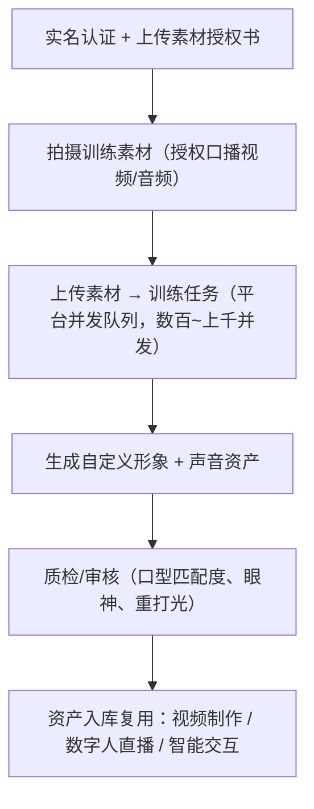
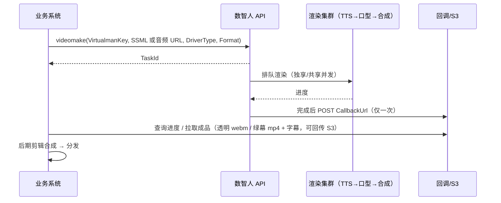
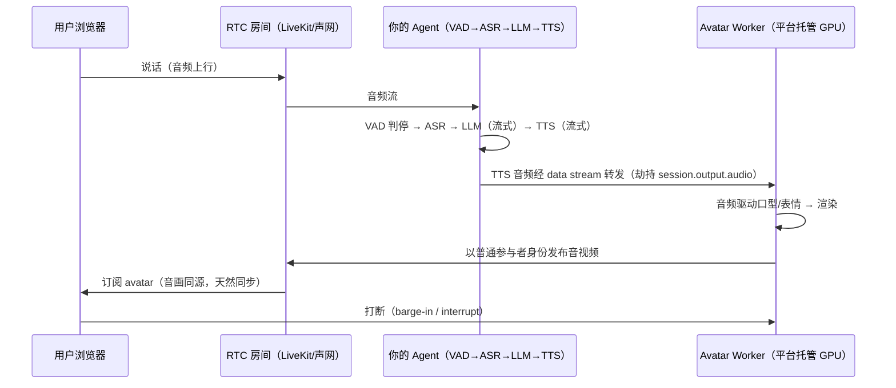
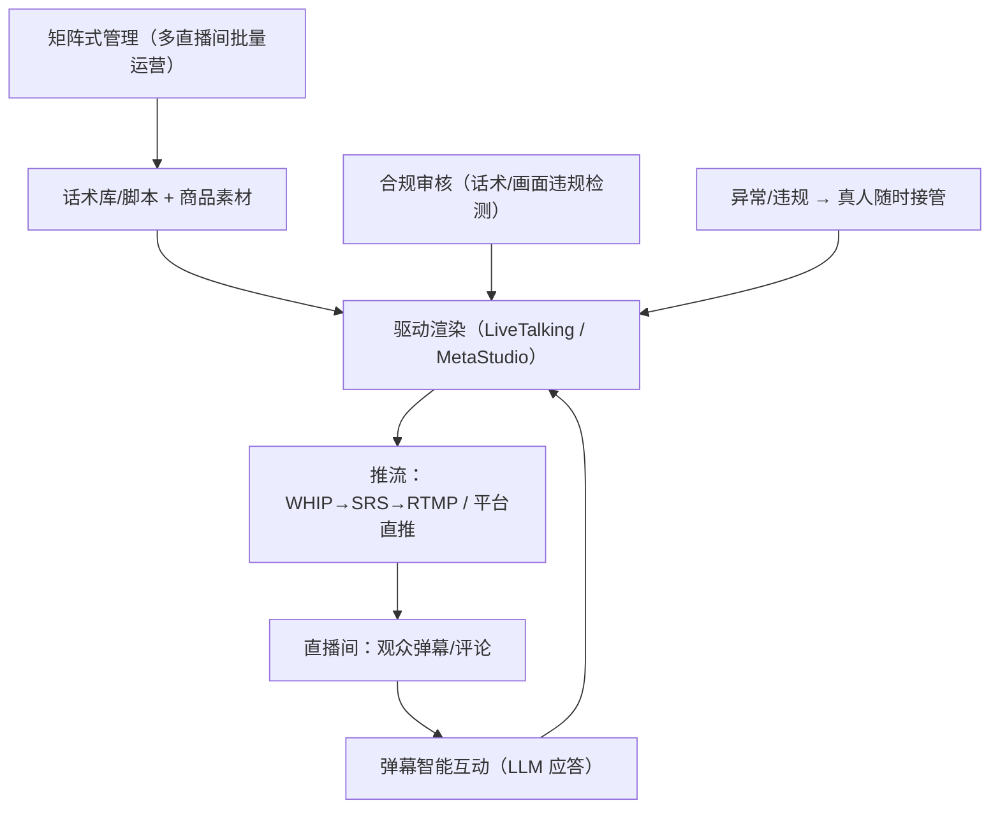

# 数字人平台调研：技术栈与业务流程

> 调研日期：2026-11-15。
> 范围：**离线视频合成型**（营销/培训/播报视频）、**实时交互型**（客服/直播/陪伴）、**3D 高保真型**（引擎渲染）三类商业平台，以及**开源自建**路线。
> 证据约定：**[一手]** = 官方文档/官网/官方仓库；**[二手]** = 第三方文章；标注「通识」的为开源社区公认事实（附仓库链接，本次未逐条复核版本号）。
> 用途：为 lyh-next 项目后续接入数字人能力提供选型依据，映射到本项目的建议见 §7。

---

## 1. TL;DR

1. **平台本质差异只在「形象 + 驱动」两层**，其余四层（语音、对话大脑、渲染传输、平台工程）高度同质。选平台 = 选形象技术与驱动/渲染的托管方式。
2. 商业平台收敛为三种交付形态：**离线合成**（异步任务：脚本/SSML → TTS → 口型驱动 → 渲染 → 回调取片）、**实时交互**（RTC 房间 + 流式 ASR/LLM/TTS + 数字人模块）、**端侧渲染**（SDK 装进 App/车机/大屏，无 GPU 服务端）。
3. 实时交互的延迟预算已有公开参考值（声网）：RTC 150–300ms + 前处理(VAD/打断) 560–940ms + ASR 400–700ms + LLM 250–1000ms + TTS 100–350ms + **数字人模块 50–200ms**（见 §6-C）。厂商宣称值：华为云 1.5s 交互 [一手]、讯飞全链路流式「亚秒级」[一手]、魔珐星云 500ms 驱动响应 [一手]、OpenAvatarChat 实测约 2.2s [一手]。
4. 形象克隆的流程高度一致：**授权 → 采集（照片/闭嘴视频/音频）→ 训练 → 资产审核 → 复用**；华为云支持数百到上千并发训练任务 [一手]。
5. 开源自建的最短路径：**LiveTalking / OpenAvatarChat / Duix** 三个框架任选，口型模型首选 MuseTalk（质量/速度平衡），TTS 首选 CosyVoice / GPT-SoVITS，ASR 用 SenseVoice + silero-vad，传输用 WebRTC（可推 SRS 转 RTMP 上直播平台）。
6. 对 lyh-next：对话大脑层（chat 模块 SSE、`AiModel` 配置化、后端记忆）可直接复用；缺口在语音层与形象/驱动/渲染/传输层。**最快落地 = 托管 Avatar API（Synthesia/D-ID/腾讯云模式：avatar worker 以普通参与者身份加入 RTC 房间）**，见 §7。

---

## 2. 平台分类与全景

| 类型           | 代表                                                                                                                      | 典型场景                                 | 技术特征                                                              | 延迟特征                                           |
| -------------- | ------------------------------------------------------------------------------------------------------------------------- | ---------------------------------------- | --------------------------------------------------------------------- | -------------------------------------------------- |
| 离线视频合成   | HeyGen、Synthesia、D-ID、腾讯云智能数智人（智影）、万兴播爆、华为云 MetaStudio（视频制作线）                              | 营销视频、课程培训、新闻播报、电商口播   | 异步任务队列 + 批量渲染，SSML/音频驱动，透明通道/绿幕输出便于后期合成 | 分钟级（任务制），无实时约束                       |
| 实时交互       | Synthesia Interactive Avatar、D-ID Agents、腾讯云 IVH、华为云 MetaStudio（交互线）、讯飞虚拟人、百度曦灵、NVIDIA ACE 蓝图 | 智能客服、数字员工、展厅导览、陪伴       | RTC 房间 + 流式 ASR→LLM→TTS→驱动，支持打断                            | 端到端 1–2s（见延迟预算表）                        |
| 3D 高保真/端侧 | 魔珐科技（星云）、Unreal MetaHuman + NVIDIA ACE、讯飞 3D 线                                                               | IP 代言、车机/大屏、机器人具身、沉浸展厅 | 引擎/端侧渲染，表情动作全栈生成，blendshape/骨骼驱动                  | 魔珐宣称 500ms 驱动响应、端侧百元级芯片可跑 [一手] |
| 开源自建       | LiveTalking、OpenAvatarChat、Duix、Linly-Talker                                                                           | 自有产品集成、二次开发、研究             | 组件可插拔（ASR/LLM/TTS/Avatar 各自替换）                             | OpenAvatarChat ~2.2s；LiveTalking 可 WebRTC 直连   |

三大云厂商定位差异 [一手/二手]：

- **腾讯云智能数智人**：播报服务最完整，API 粒度细到 SSML、音色、情感、并发类型（§4.5）。
- **华为云 MetaStudio**：盘古数字人大模型 + 全球算力网，强在训练管线与直播矩阵 [一手]。
- **百度**：曦灵平台 + 千帆 AppBuilder 数字人应用（低代码创建、调试、SDK 集成）[一手]。

---

## 3. 技术栈六层拆解

> 阅读方式：每一层给出「做什么 → 商业平台做法 → 开源做法」。这也是评估任何数字人方案的通用清单。

### 3.1 L1 形象生产层

| 路线           | 说明                                              | 代表                                                                                                                                                 |
| -------------- | ------------------------------------------------- | ---------------------------------------------------------------------------------------------------------------------------------------------------- |
| 2D 照片克隆    | 一张/几张肖像照生成可播报形象，几分钟内可用       | HeyGen Photo Avatar [一手]、D-ID V2 Photo Avatar [一手]、NVIDIA Audio2Face-2D（一张肖像照 + 声音 → 2D 数字人）[一手]                                 |
| 2D 视频克隆    | 上传一段授权的闭嘴口播视频训练「分身」，效果最稳  | 华为云 MetaStudio 自定义形象 [一手]、HeyGen Instant Avatar（通识）、万兴播爆形象克隆 [二手]                                                          |
| 3D 建模        | 扫描/捏脸/建模 + 绑定，成本高但表现力最强         | 讯飞捏脸 + 3D 超写实 [一手]、魔珐 3D 全栈 [一手]、Unreal MetaHuman（通识，[MetaHuman](https://www.unrealengine.com/en-US/metahuman)）                |
| 卡通/2D 引擎   | Live2D / VRM（three.js 可渲染），二次元与轻量场景 | 通识（[Live2D](https://www.live2d.com/)、[VRM](https://vrm.dev/)）                                                                                   |
| NeRF/3DGS 路线 | 用神经辐射场拟合真人头部，学术出身                | ER-NeRF（LiveTalking 内置支持 [一手]，[Fictionarry/ER-NeRF](https://github.com/Fictionarry/ER-NeRF)）；商业化主流已转向「视频克隆 + diffusion 口型」 |

### 3.2 L2 驱动层（口型/表情/动作）

| 能力                            | 主流技术                                                                      | 出处                                                                                         |
| ------------------------------- | ----------------------------------------------------------------------------- | -------------------------------------------------------------------------------------------- |
| 音频→口型（2D 重绘/inpainting） | Wav2Lip、MuseTalk、Ultralight-Digital-Human、LiteAvatar、LAM Audio2Expression | LiveTalking 支持 4 种 [一手]；OpenAvatarChat 组件表 [一手]                                   |
| 音频→口型（diffusion 生成式）   | SoulX-FlashHead（扩散式实时流式 talking head）、Hallo/EchoMimic（离线高质量） | [Soul-AILab/SoulX-FlashHead](https://github.com/Soul-AILab/SoulX-FlashHead) [一手]；其余通识 |
| 音频→3D blendshape              | NVIDIA Audio2Face-3D（blendshape + 头/身微动画）                              | [一手]（NVIDIA blog）                                                                        |
| 音频特征                        | wav2vec2 / HuBERT 提取音频特征驱动 NeRF 类模型                                | LiveTalking ernerf 配置 [一手]                                                               |
| 文本→表情/动作                  | 语义/情绪/动作意图解析，实时生成手势与表情                                    | 魔珐星云「具身驱动」[一手]                                                                   |
| 驱动信号类型                    | 文本驱动 / 原声音频驱动 / 变声驱动                                            | 腾讯云 `DriverType: Text / OriginalVoice / ModulatedVoice` [一手]                            |
| 细节增强                        | AI 眼神纠正、智能重打光、背景融合                                             | 华为云 MetaStudio [一手]                                                                     |
| 播报控制                        | SSML 标签（停顿、多音字、语速、情感标签）                                     | 腾讯云 SSML 规范 [一手]                                                                      |

### 3.3 L3 语音层（TTS / 声音克隆 / ASR / VAD / 情感）

| 环节       | 商业做法                                                                                                                                                                                                                 | 开源做法                                                                                                                             |
| ---------- | ------------------------------------------------------------------------------------------------------------------------------------------------------------------------------------------------------------------------ | ------------------------------------------------------------------------------------------------------------------------------------ |
| TTS        | Azure、ElevenLabs、Cartesia、Amazon Polly、微软（D-ID 官方 TTS 列表 [一手]）；腾讯云音色/情感参数（`TimbreKey`、`EmotionCategory`、`EmotionIntensity`）[一手]；火山（豆包）、阿里千问语音、腾讯语音、Azure 均有 API 可插 | CosyVoice、GPT-SoVITS、Fish Speech、EdgeTTS、XTTS；LiveTalking 还支持 omni-tts（vllm-omni 托管 qwen3-tts/cosyvoice/voxcpm 等）[一手] |
| 声音克隆   | 华为云上传素材训练声音资产 [一手]；各云「音色复刻」产品                                                                                                                                                                  | GPT-SoVITS / CosyVoice 少样本克隆（通识）；LiveTalking 用 `REF_FILE` 指定参考音色 [一手]                                             |
| ASR        | Riva Parakeet NIM（NVIDIA 蓝图）[一手]；声网内置 ASR TTLW 指标 400–700ms [一手]                                                                                                                                          | SenseVoice（OpenAvatarChat 默认 [一手]）、FunASR、Whisper（通识）                                                                    |
| VAD / 打断 | AIVAD「优雅打断」560–940ms [一手]；NVIDIA barge-in [一手]                                                                                                                                                                | silero-vad [一手]；OpenAvatarChat 0.6.0 支持手动打断 + 双工打断 [一手]                                                               |
| 流式化     | 讯飞：流式 ASR 边收音边解码 → 轻量 LLM 推测解码边推 TTS → 流式 TTS 同时驱动唇形参数 → 渲染音画对齐，全链路亚秒级 [一手]                                                                                                  | OpenAvatarChat 分片流水线（音频切片/token/帧并行推进）[一手]                                                                         |

### 3.4 L4 对话大脑层（与 lyh-next chat 模块同层）

| 能力       | 商业做法                                                                                                                                             | 说明                                 |
| ---------- | ---------------------------------------------------------------------------------------------------------------------------------------------------- | ------------------------------------ |
| LLM 接入   | 全部支持 OpenAI 兼容 API 或自带大模型（华为盘古、讯飞星火 [一手]）                                                                                   | 与本项目 `AiModel` 表思路一致        |
| 语音到语音 | OpenAI Realtime / Qwen-Omni（OpenAvatarChat 有 `chat_with_qwen_omni` 预设 [一手]）；Synthesia 称之为 voice-to-voice realtime，为「已验证路径」[一手] | 省掉级联三段，但可控性低             |
| RAG / 知识 | D-ID Knowledge 库 [一手]；NVIDIA NeMo Retriever（embedding + reranking）[一手]                                                                       | 数字员工场景必备                     |
| 记忆       | D-ID Memories [一手]                                                                                                                                 |                                      |
| 工具/Agent | D-ID Tools + MCP Server [一手]；OpenAvatarChat Agent 模式（工具调用/人设/长期记忆/上下文压缩/视觉感知）[一手]                                        | 数字人从「播报」升级为「可执行动作」 |

### 3.5 L5 渲染与传输层

| 场景         | 技术                                                                                                 | 出处                                                        |
| ------------ | ---------------------------------------------------------------------------------------------------- | ----------------------------------------------------------- |
| 实时音视频   | WebRTC（LiveKit 为国际事实标准：Synthesia/D-ID/HeyGen 流式均基于 LiveKit 房间 [一手]）；国内声网 RTC | Synthesia IA 架构图 [一手]、D-ID Echo/Agent Sessions [一手] |
| 推流上直播   | WebRTC WHIP 推到 SRS → SRS 转 RTMP，或直接 RTMP 推流；虚拟摄像头输出（接 OBS）                       | LiveTalking 三种传输模式 [一手]                             |
| 云端 3D 渲染 | Omniverse Renderer 或 Unreal Engine Renderer 二选一                                                  | NVIDIA ACE 蓝图 [一手]                                      |
| 端侧渲染     | 魔珐 AI 端渲：无引擎无 GPU、百元级芯片、兼容信创 [一手]；Duix Android/iOS 一键部署 [一手]            | 适合车机/大屏/机器人                                        |
| 离线合成输出 | 透明通道 webm（Alpha）、透明 mov、绿幕 mp4 + 字幕文件，成品可回传 S3                                 | 腾讯云 `VideoParam.Format` [一手]                           |
| 前端渲染     | avatar 作为 RTC 房间普通参与者，任何 LiveKit/RTC 客户端直接订阅，无需专属前端代码                    | Synthesia [一手]                                            |

### 3.6 L6 平台工程层

| 能力         | 做法                                                                                                                  | 出处                                          |
| ------------ | --------------------------------------------------------------------------------------------------------------------- | --------------------------------------------- |
| 任务编排     | 提交任务返回 `TaskId`，进度查询接口 + 回调 URL                                                                        | 腾讯云 videomake [一手]                       |
| GPU 并发调度 | 独享/共享并发两种类型（独享优先）                                                                                     | 腾讯云 `ConcurrencyType` [一手]               |
| 训练并发     | 数百到上千并发训练任务                                                                                                | 华为云 [一手]                                 |
| 并发配额     | Freemium 1 路、付费 100 路并发会话 + 分钟数配额，超限返回结构化错误（`429 concurrency_limit` / `402 quota_exceeded`） | Synthesia [一手]                              |
| 合规         | 实名认证 + 素材授权书（肖像/声音）前置；直播场景违规审核                                                              | 华为云 [一手]（「实名安全认证后可自助制作」） |
| 商业模式     | 订阅 + credits/分钟数 + API 计费；私有化/一体机（讯飞智能交互机、虚拟人直播机 [一手]；魔珐交互一体机 [二手]）         |                                               |
| 可观测性     | 每轮对话的 `asr_ttlw / llm_ttfb / llm_ttfs / tts_ttfb` 指标，经客户端回调或 webhook 下发                              | 声网 agent metrics [一手]                     |

---

## 4. 代表平台调研卡

### 4.1 HeyGen（国际 · 离线合成 + 实时流式）

- **定位**：全球化 AI 视频生成平台，营销/社媒视频首选；也有实时 streaming avatar 产品线。
- **技术方案** [一手]：官方文档覆盖 [Photo to Avatar](https://developers.heygen.com/docs/avatar-from-photo.md)（照片生成形象）、[Audio to Video](https://developers.heygen.com/audio-to-video)（音频驱动视频）、[Interactive Sessions](https://developers.heygen.com/docs/interactive-sessions.md)（实时会话）；前端 SDK 为 [`@heygen/streaming-avatar`](https://www.npmjs.com/package/@heygen/streaming-avatar)。研究页 [Avatar Inference at Scale](https://www.heygen.com/research/avatar-inference-at-scale) 披露其长视频流式推理基础设施（标题级事实，正文未能抓取）。
- **业务流程**：创建形象（照片/视频克隆，含授权声明）→ 写脚本/传音频 → 选形象+音色+背景 → 提交渲染 → 取片/分享；实时线为「SDK 加入 RTC 会话 → 发文本/音频 → avatar 说话」。
- **商业模式**：订阅 + credits + API 计费（通识）。
- **评注**：形象质量与多语种第一梯队；国内访问与结算有门槛。

### 4.2 Synthesia（国际 · 企业视频 + 实时交互）

- **定位**：企业级 AI 视频平台（培训/合规/内部沟通），Interactive Avatar 面向自建应用。
- **技术方案** [一手]（[IA 架构文档](https://docs.synthesia.io/reference/ia-overview.md)）：**BYO LiveKit 语音代理 + `synthesia.AvatarSession` 插件**。插件完成鉴权 → 派发托管 avatar worker → worker 以普通参与者身份（`synthesia-avatar-agent`）加入你的 LiveKit 房间 → 你的 agent 产生的 TTS 音频经 LiveKit data stream 转给 worker → worker 做 GPU 渲染 + 唇形同步并把音视频发回房间。**代理进程零 GPU、零视频代码，渲染全托管**；TTS 完全 BYO（Synthesia 音色不走该 API）。
- **业务流程**：用户在房间说话 → 你的 STT→LLM→TTS（或 realtime 模型）→ 插件劫持 `session.output.audio` → avatar worker 渲染 → 用户订阅 avatar 参与者。
- **工程细节** [一手]：必须在 `session.start()` 前挂载；冷启动 join 超时默认 30s；无内置重连（恢复=重新 `start()`）；错误带 `retryable`/`retry_after`；并发上限 Freemium 1 路、付费 100 路。
- **评注**：把「数字人」拆成了可组合的架构角色（你管大脑，它管脸），是**接入模式设计的最佳参考**。

### 4.3 D-ID（国际 · 实时 Agent + 视频 API）

- **定位**：老牌 talking-head 平台，Agents API 走「平台出大脑外壳、你插 LLM」路线。
- **技术方案** [一手]（[Echo Sessions](https://docs.d-id.com/docs/echo-sessions-quickstart) 等官方文档）：Realtime 全家桶基于 **LiveKit**：Agents（自带对话编排：Knowledge/RAG、Memories、LLMs、Tools、MCP Server）、Agent Sessions、**Echo Sessions**（`session_type: "echo"`——你的后端拿 `echo_token` 加入同一 LiveKit 房间，通过 `did.audio-stream` byte stream 直接推音频，avatar 实时对口型，完全跳过 STT/LLM/TTS）、支持 `interrupt` 属性打断。视频线：V4 Expressive / V3 Pro / V3 Instant / V2 Photo 四档形象 + Video Translate。
- **业务流程**：创建 Agent（绑形象/音色/知识库/工具）→ `POST /v2/agents/:id/sessions` 拿 `session_url + session_token` → 前端用 Agents Embed SDK 或 LiveKit 客户端加入 → 说话/发文本/推音频。
- **商业模式**：API 计费（分钟/并发），pricing 页公开（通识）。
- **评注**：**Echo 模式对我们最有启发**——平台只负责「脸」，音频随便来源（自建 TTS、真人、录音），接入面最小。

### 4.4 NVIDIA ACE（国际 · 技术栈供应商）

- **定位**：不做终端产品，提供数字人「全栈积木」+ 参考蓝图。
- **技术方案** [一手]（[NVIDIA blog](https://developer.nvidia.com/blog/expanding-ai-agent-interface-options-with-2d-and-3d-digital-human-avatars/)）：Digital Human 蓝图链路 = **Riva Parakeet ASR NIM → RAG（NeMo Retriever embedding + reranking + LLM NIM）→ Riva TTS → Audio2Face-2D / Audio2Face-3D NIM（blendshape + 头身微动画）→ Omniverse 或 Unreal Engine 渲染**；多语种 NMT + 智能打断 barge-in；Audio2Face-2D 仅需一张肖像照 + 声音。另有 [Audio2Face-3D NIM 文档](https://docs.nvidia.com/ace/latest/) 与 UE 插件工作流（K8s + Unreal 渲染农场）[一手]。
- **评注**：3D 高保真路线的事实标准积木；Audio2Face 动画模型已开源（NVIDIA blog 相关文章 [一手]）。

### 4.5 腾讯云智能数智人（国内 · 播报/视频 + 直播 + 交互）

- **定位**：腾讯智影背后的云服务（产品 [1240 智能数智人](https://cloud.tencent.com/document/product/1240)），播报 API 最细。
- **技术方案** [一手]（[视频制作接口-基础版](https://cloud.tencent.com/document/product/1240/81268)）：`POST /v2/ivh/videomaker/broadcastservice/videomake`：
  - `VirtualmanKey`：预置形象（角色/服装/姿态/分辨率枚举，接口可查询）；
  - `InputSsml`：SSML 播报文本（上限 2 万字，支持多音字 `<phoneme>` 等）；
  - `SpeechParam`：语速 0.5–1.5、音色、音量、情感类别与强度、音色语种；
  - `DriverType`：`Text`（文本驱动）/ `OriginalVoice`（原声驱动）/ `ModulatedVoice`（变声驱动）；
  - `VideoParam.Format`：`TransparentWebm`（Alpha 透明）/ `TransparentMov` / `Mp4`（绿幕）；
  - 返回 `TaskId` → 进度查询接口 + `CallbackUrl` 回调；成品/字幕可回传 S3；`ConcurrencyType` 独享/共享并发。
- **业务流程**：选形象/音色 → SSML 或音频 → 提交任务 → GPU 队列渲染（TTS→口型→合成→字幕）→ 回调取片（透明通道素材供后期剪辑）。
- **评注**：**「透明通道输出」是它区别于海外平台的关键**——数字人当「素材」融进剪辑管线，而非整片交付。

### 4.6 华为云 MetaStudio（国内 · 全栈：训练/制作/直播/交互）

- **定位**：依托盘古数字人大模型 + 云上算力网的全栈数字人服务 [一手]（[产品优势页](https://support.huaweicloud.com/productdesc-metastudio/metastudio_01_0002.md)）。
- **技术方案** [一手]：控制台自助——上传授权 → 拍摄训练音视频 → 训练生成自定义形象与声音；口型匹配度 >95%、AI 眼神纠正、智能重打光、人物走动/侧身训练、20+ 语种一次母语训练多语种泛化；支持几百到上千并发训练任务。
- **业务流程**：
  - **视频制作/直播**：选背景/声音/形象 → 文本或音频智能驱动 → 制作视频或开播；直播支持持物/实景直播、**弹幕智能互动、真人随时接管、矩阵式管理**。
  - **智能交互**：开放的 Web SDK + 形象驱动 API + 数字人大脑 API（CBS 问答机器人 / 盘古大模型），宣称 **1.5s 超低时延**。
- **评注**：国内「训练→资产→复用」闭环最完整的官方描述样本，直播线（真人接管/矩阵）可作流程蓝本。

### 4.7 科大讯飞 虚拟人交互平台（国内 · 全链路流式实时）

- **定位**：星火大模型 + 虚拟人的一站式方案；产品矩阵：讯飞智作（视频合成）、智能交互机（一体机）、虚拟人直播机、虚拟人能力开放 API、企业大屏助手、移动数字人 [一手]（[虚拟人交互平台](https://virtual-man.xfyun.cn/)）。
- **技术方案** [一手]（[流式驱动文章](https://virtual-man.xfyun.cn/content/4728.html)）：**全链路流式驱动引擎**——流式 ASR 边收音边解码（首字延迟大幅降低）→ 轻量化大模型推测解码、边生成文本边推 TTS → 流式语音合成不用等整句生成即输出音频片段、同时驱动唇形与微表情参数 → 渲染管线同步音画对齐；**全链路延迟压至亚秒级**；多线程解耦避免阻塞，显存多路并发共享。
- **形象资产**：2D 真人 / 3D 超写实 / 卡通 / 美型 + 服装发型配饰资产 + 动作表情库 + 自定义捏脸 [一手]。
- **评注**：其「流式节点并行」架构描述与声网延迟表互相印证，是理解实时数字人延迟优化的最佳中文一手材料。

### 4.8 百度（曦灵平台 + 千帆 AppBuilder 数字人应用）

- **定位**：曦灵为数字人平台（2D/3D/卡通形象，覆盖视频生成、直播、智能交互）[二手]（[架构分享](https://zhuanlan.zhihu.com/p/593096669)，未抓取正文）；AppBuilder 提供[数字人应用：创建、调试和 SDK 集成](https://ai.baidu.com/ai-doc/AppBuilder/2m3qqz64d) [一手]（标题与入口确认）。
- **技术方案**：依托文心大模型做数字人大脑，平台侧提供形象/声音资产与编排（二手综合，细节以官方文档为准）。
- **评注**：适合已有百度云生态的企业；信息透明度低于华为/腾讯，选型时需走商务获取技术白皮书。

### 4.9 硅基智能 Duix（国内 · 开源 + 商用一体机）

- **定位**：DUIX = Dialogue User Interface System，硅基智能 AI 数字人智能交互平台；**交互能力开源**，开发者自行接入大模型/ASR/TTS，实现实时交互，Android/iOS 一键部署 [一手]（[duix.ai 仓库](https://github.com/CryoMind-AI/duix.ai)）。
- **技术方案**：端侧渲染路线（App 内渲染，服务端只出推理 API），大模型/ASR/TTS 全部可插拔；另有商用版与直播产品线（公司为上市企业 [二手]）。
- **评注**：国内开源端侧方案代表；如果目标是「App 内数字人」而非 WebRTC 网页，优先看它。

### 4.10 魔珐科技（国内 · 3D 高保真 + 端侧生成）

- **定位**：3D 超写实数字人与「具身驱动」，星云平台面向大模型/智能体/机器人/IP 场景 [一手]（[具身驱动](https://www.xingyun3d.com/capabilities/realtime)、[星云平台发布](http://business.china.com.cn/2026-02/02/content_43348418.shtml) [二手]）。
- **技术方案** [一手]：**全栈多模态实时生成大模型**——文本输入 → 解析语义/情绪/动作意图（垂域小模型，低延时低成本）→ 实时生成语音（小模型 ~100ms / 大模型 ~500ms）+ 3D 表情动作手势 → **AI 端侧渲染**（无传统引擎、无 GPU、百元级芯片可跑、100% 兼容国产信创）；500ms 驱动响应、支持随时打断、宣称千万级设备并发。
- **评注**：「生成式表情动作 + 端侧渲染」是把数字人铺到海量终端（车机/电视/机器人）的路线，与 WebRTC 云渲染路线形成两极。

### 4.11 其他

- **万兴播爆（Virbo）**：面向个人 IP/出海营销，提供形象克隆与在线形象定制 [二手]（[极客公园报道](https://www.geekpark.net/news/337096)）。
- **Unreal MetaHuman**：3D 逼真数字人的行业标准资产与绑定方案，配合 ACE/UE 渲染器上云 [一手]（NVIDIA blog 提及 UE 渲染选项）。
- **UneeQ、Tavus 等**：海外同类实时 avatar 服务，架构与 Synthesia/D-ID 同型（通识）。

---

## 5. 开源生态与自建路径

### 5.1 三个可直接跑通的开源框架

| 框架                                                                                                             | 架构                                                                                                                                   | 组件                                                                                                                                                                                                                                                                              | 传输                                                            | 适合                                                                                                                                                                                               |
| ---------------------------------------------------------------------------------------------------------------- | -------------------------------------------------------------------------------------------------------------------------------------- | --------------------------------------------------------------------------------------------------------------------------------------------------------------------------------------------------------------------------------------------------------------------------------- | --------------------------------------------------------------- | -------------------------------------------------------------------------------------------------------------------------------------------------------------------------------------------------- |
| [OpenAvatarChat](https://github.com/HumanAIGC-Engineering/OpenAvatarChat) [一手]                                 | Python 单机 + Web UI（v0.6.0 已拆出 [OpenAvatarChat-WebUI](https://github.com/HumanAIGC-Engineering/OpenAvatarChat-WebUI) 前后端分离） | RTC: gradio-webrtc；VAD: silero-vad；ASR: SenseVoice / Qwen-Omni；LLM: OpenAI 兼容 API / Qwen-Omni / Agent 模式（工具调用、人设、长期记忆、上下文压缩、视觉感知）；TTS: CosyVoice / API；Avatar: LiteAvatar / LAM Audio2Expression / MuseTalk / SoulX-FlashHead（扩散式实时流式） | WebRTC                                                          | **架构最干净的参考实现**：YAML 配置即组装（`chat_with_*.yaml` 预设表），实测平均响应 ~2.2s，支持手动打断 + 双工打断                                                                                |
| [LiveTalking](https://github.com/lipku/LiveTalking) [一手]（[使用文档](https://doc.livetalking.ai/docs/usage/)） | Python 服务，模型/传输/TTS 三者独立可选                                                                                                | 数字人模型：wav2lip（默认）/ musetalk / ernerf（wav2vec 或 HuBERT 音频特征、支持全身视频贴回）/ Ultralight-Digital-Human；自定义形象 = 一段闭嘴视频跑 `genavatar`                                                                                                                 | WebRTC p2p / WHIP 推流到 SRS / RTMP 推流 / 虚拟摄像头（接 OBS） | **做直播和工程化最实用**：TTS 可插（edgetts、GPT-SoVITS、XTTS、omni-tts 托管 qwen3-tts/cosyvoice/fishspeech、腾讯云、火山豆包、阿里千问、Azure）、动作编排、LLM 对话、多并发、语音输入，另有商用版 |
| [Duix.ai](https://github.com/CryoMind-AI/duix.ai)（硅基智能）[一手]                                              | 端侧 SDK：Android/iOS 一键部署，服务端只出推理 API                                                                                     | 大模型 / ASR / TTS 全部可插拔                                                                                                                                                                                                                                                     | App 内渲染（非 WebRTC）                                         | 目标是 **App/车机/大屏**里的数字人 Agent 时优先看                                                                                                                                                  |

### 5.2 口型/驱动模型选型

| 模型                                         | 类型                             | 特点                                               | 出处                                                                                                                     |
| -------------------------------------------- | -------------------------------- | -------------------------------------------------- | ------------------------------------------------------------------------------------------------------------------------ |
| Wav2Lip                                      | 2D 唇部重绘                      | 最快最简单、清晰度一般，实时入门                   | LiveTalking 默认 [一手]、[repo](https://github.com/Rudrabha/Wav2Lip)（通识）                                             |
| MuseTalk                                     | 2D 唇部重绘（隐空间 inpainting） | 实时与质量的平衡点，**实时场景首选**               | [TMElyralab/MuseTalk](https://github.com/TMElyralab/MuseTalk)（OpenAvatarChat 组件表 [一手]）                            |
| SoulX-FlashHead                              | diffusion 流式 talking head      | 生成式质量 + 实时流式，OpenAvatarChat 0.6.0 新集成 | [Soul-AILab/SoulX-FlashHead](https://github.com/Soul-AILab/SoulX-FlashHead) [一手]                                       |
| Ultralight-Digital-Human                     | 超轻量                           | 端侧/低算力                                        | [anliyuan/Ultralight-Digital-Human](https://github.com/anliyuan/Ultralight-Digital-Human)（LiveTalking 文档引用 [一手]） |
| LiteAvatar / LAM Audio2Expression            | 2D/3D 表情驱动                   | OpenAvatarChat 默认形象                            | HumanAIGC / aigc3d（组件表 [一手]）                                                                                      |
| ER-NeRF                                      | NeRF 拟真人头                    | 训练重、学术验证充分                               | [Fictionarry/ER-NeRF](https://github.com/Fictionarry/ER-NeRF)（LiveTalking 文档引用 [一手]）                             |
| SadTalker / LivePortrait / EchoMimic / Hallo | 单图/视频驱动的离线生成          | 离线视频合成、素材生产                             | 通识（GitHub 公开仓库）                                                                                                  |
| NVIDIA Audio2Face-2D / 3D                    | blendshape 驱动                  | 3D 路线标准件，2D 版仅需肖像照                     | NVIDIA blog [一手]                                                                                                       |

### 5.3 语音层开源选型

- **TTS**：CosyVoice（[FunAudioLLM/CosyVoice](https://github.com/FunAudioLLM/CosyVoice)，OpenAvatarChat 默认 [一手]）、GPT-SoVITS（少样本克隆）、Fish Speech、omni-tts/vllm-omni 聚合部署 [一手]。
- **ASR**：SenseVoice（阿里，多语种 + 情感）、FunASR/Paraformer、Whisper（通识）。
- **VAD**：silero-vad [一手]。

### 5.4 两条自建参考架构

```text
A. 云端 GPU + WebRTC（LiveTalking / OpenAvatarChat 型）
浏览器 ──WebRTC──▶ 媒体网关（LiveKit / SRS / aiortc）
                     │ 音频帧
                     ▼
        VAD(silero) → ASR(SenseVoice) → LLM(OpenAI 兼容) → TTS(CosyVoice 流式)
                     │ 音频切片
                     ▼
        口型驱动(MuseTalk/FlashHead) → 推理 GPU → 视频帧 → 回流媒体网关 → 浏览器
                     └──(直播线)──▶ WHIP→SRS→RTMP → 直播平台 / 虚拟摄像头→OBS

B. 端侧渲染（Duix / 魔珐星云型）
App/车机/大屏 SDK ──文本/音频──▶ 服务端：LLM → 语音/表情/动作参数（流式）
SDK 本地渲染 3D 形象（无 GPU 服务端，百元级芯片可跑）
```

取舍：A 路线形象质量高、可做直播，但要养 GPU 与媒体服务器；B 路线成本与并发极优、隐私好，但 3D 资产制作门槛高。

---

## 6. 业务流程梳理

### 6-A 形象/声音克隆（锚点：华为云 MetaStudio [一手]）



要点：**授权前置**（无授权书不能训练）、一次训练无限次使用、2D 视频克隆是商业主流（NeRF/3D 主要留给高保真场景）。

### 6-B 离线视频生产（锚点：腾讯云智能数智人 API [一手]）



要点：任务制（`TaskId` + 轮询/回调）、SSML 控制播报细节、**透明通道输出**让数字人作为「素材」进入剪辑管线；驱动源可以是文本（平台 TTS）也可以自带音频（`OriginalVoice`）。

### 6-C 实时交互（锚点：Synthesia [一手] / D-ID [一手] / 声网 [一手]）



**延迟预算表**（声网对话式 AI 引擎实测口径 [一手]，单位 ms）：

| 模块       | 指标                         | 典型范围   |
| ---------- | ---------------------------- | ---------- |
| RTC        | 采集/编码/传输/播放          | 150–300    |
| 算法前处理 | VAD、优雅打断（AIVAD）       | 560–940    |
| ASR        | TTLW（说完到识别完最后一词） | 400–700    |
| LLM        | TTFB / TTFS（首字节/首句）   | 250–1000   |
| TTS        | TTFB                         | 100–350    |
| 数字人     | 音频首帧 → 音视频首帧对齐    | **50–200** |

级联架构粗加和 ≈ 1.5–4s；流式优化（首帧先行、边生成边播）后体感 1–2s。厂商宣称值：华为云 1.5s [一手]、讯飞亚秒级 [一手]、魔珐 500ms 驱动响应 [一手]、OpenAvatarChat ~2.2s [一手]。

### 6-D 数字人直播（锚点：华为云 [一手] / LiveTalking [一手]）



要点：直播是「离线合成 + 实时交互」的合体——话术预生成（省 LLM 延迟）+ 弹幕实时应答 + 审核与真人接管兜底；技术选型上 LiveTalking 的 RTMP/虚拟摄像头输出正是为这个场景设计的。

---

## 7. 结合本项目的集成建议（lyh-next）

### 7.1 现状映射：六层里已具备什么

| 层                      | 现状                                                                                                                                                                      | 依据                                                                            |
| ----------------------- | ------------------------------------------------------------------------------------------------------------------------------------------------------------------------- | ------------------------------------------------------------------------------- |
| L4 对话大脑             | ✅ **可直接复用**：OpenAI 兼容 SSE 逐帧透传、`AiModel` 表配置化（baseUrl/apiKey 不走环境变量）、多轮记忆后端装配（`apps/backend/src/chat/prompt.ts`）、会话按用户隔离     | [chat.md](../features/chat.md)                                                  |
| 会话/鉴权               | ✅ Nest 托管 JWT cookie + 全局守卫 + `@Public()`，新模块天然继承                                                                                                          | [auth.md](../features/auth.md)                                                  |
| 实时通道                | ⚠️ **有设计未实现**：[realtime.md](../features/realtime.md) 已定原生 WS `/api/ws`、`tokenVersion` 吊销、`wss` 与反代 Upgrade 约定；无 socket.io；**无 WebRTC/媒体服务器** | [realtime.md](../features/realtime.md)                                          |
| L3 语音                 | ❌ 无 TTS/ASR/VAD                                                                                                                                                         | —                                                                               |
| L1/L2/L5 形象·驱动·渲染 | ❌ 无                                                                                                                                                                     | —                                                                               |
| L6 工程底座             | ✅ 统一信封 `{code,message,data}`、业务码段（1xxxx/2xxxx/3xxxx）、限流、pino 日志、`X-Request-Id`、Prisma 多文件 schema                                                   | [err-handing.md](../features/err-handing.md)、[chat.md §3](../features/chat.md) |

**结论：数字人 = 现有 chat 能力（大脑）+ 新增语音层 + 新增形象/驱动/渲染/传输层。** 大脑不必重建，接入方式上让数字人会话复用 `Conversation/ChatMessage` 记忆即可。

### 7.2 三条落地路线对比

| 路线                               | 做法                                                                                                        | 优点                                                                  | 代价                                                                | 适配判断                                          |
| ---------------------------------- | ----------------------------------------------------------------------------------------------------------- | --------------------------------------------------------------------- | ------------------------------------------------------------------- | ------------------------------------------------- |
| **R1 托管 Avatar API（推荐起步）** | Synthesia IA / D-ID（海外）或腾讯云 IVH、华为云 MetaStudio SDK（国内）；后端只做编排与 token 下发，渲染托管 | 1–2 周可出 Demo；零 GPU 运维；架构就是 Synthesia 的「你管大脑它管脸」 | 按量计费；海外平台有数据出境/结算问题 → **国内业务选腾讯云/华为云** | 与本项目「服务端编排 + 浏览器直连」模式契合度最高 |
| **R2 自建云端**                    | LiveTalking 或 OpenAvatarChat + LiveKit/SRS + CosyVoice/SenseVoice + 自有 GPU                               | 完全可控、无按分钟计费；能做直播推流                                  | GPU 采购/运维、模型部署与并发调优（多并发/显存共享是难点）          | R1 验证后替换关键层；或数据敏感场景直接上         |
| **R3 端侧 SDK**                    | Duix.ai（App）或魔珐星云（车机/大屏/机器人）                                                                | 无 GPU 服务端、超低成本并发                                           | Web 端不适用；3D 资产门槛                                           | 本项目是 Web 应用，暂不适用                       |

### 7.3 模块与数据模型草图（R1 为主，预留 R2 适配器）

**后端** `apps/backend/src/digital-human/`（对齐 chat 模块的组织方式）：

```text
dh.module.ts                  # 注册控制器/服务
dh-avatar.controller.ts       # 形象/音色资产管理（仿 models.controller.ts 的 configs 增删改查）
dh-session.controller.ts      # POST /api/dh/sessions（创建 RTC 会话，下发 room token）
                              # DELETE /api/dh/sessions/:id；POST /api/dh/sessions/:id/interrupt
dh-session.service.ts         # 编排：复用 chat.service 装配上下文 → LLM 流式 → 分句
                              #   → tts.provider → 音频/驱动信号 → RTC/托管 worker
providers/                    # 适配器模式（对齐 chat 的 upstream 思路）
  ├─ synthesia.provider.ts    # LiveKit + synthesia.AvatarSession（服务端伪托管路径）
  ├─ did.provider.ts          # agents/echo sessions（LiveKit byte stream 推音频）
  ├─ tencent-ivh.provider.ts  # 腾讯云智能交互（国内合规首选）
  └─ livetalking.provider.ts  # R2 自建：HTTP/WS 驱动 LiveTalking
dh-rtc.service.ts             # LiveKit/声网 token 签发、房间生命周期
```

**前端**：`apps/frontend/src/app/digital-human/page.tsx` + `src/components/digital-human/`；用 `livekit-client`（或供应商 SDK）订阅 avatar 参与者——Synthesia 明确说明 avatar 是房间普通参与者，**前端无需专属渲染代码** [一手]；请求仍走 `src/utils/api.ts` 统一封装。

**Prisma**（新增 `apps/backend/prisma/digital-human.prisma`，遵循多文件 schema 约定）：

```prisma
model DhAvatarAsset {
  id              String   @id @default(cuid())
  displayName     String
  kind            String   // photo | video_clone | 3d | cartoon
  provider        String   // synthesia | did | tencent_ivh | livetalking
  providerAssetId String?  // 平台侧资产 id（HeyGen avatar_id / VirtualmanKey 同类）
  status          String   @default("ready") // training | ready | failed
  ownerId         String?  // 用户隔离，对齐 Conversation.userId
  createdAt       DateTime @default(now())
}

model DhVoiceAsset {
  id          String   @id @default(cuid())
  displayName String
  provider    String
  voiceKey    String   // TimbreKey / voice_id / REF_FILE
  ownerId     String?
}

model DhSession {
  id             String    @id @default(cuid())
  userId         String
  avatarId       String
  voiceId        String
  conversationId String?   // 复用 chat 的 Conversation 承载记忆
  roomId         String?   // RTC 房间
  status         String    @default("idle") // idle | streaming | closed
  createdAt      DateTime  @default(now())
}

model DhRenderTask {          // 离线合成线（§6-B）
  id          String    @id @default(cuid())
  provider    String
  taskId      String?   // 平台 TaskId
  status      String    @default("submitted")
  outputUrl   String?
  subtitleUrl String?
}
```

**契约约定**：业务码启用 **4xxxx 段**（对齐 [err-handing.md](../features/err-handing.md) 码表分段习惯）；JSON 接口一律走统一信封；打断走 WS 事件 `dh.interrupt`（鉴权/生命周期遵循 realtime.md 已定约定）；TTS/驱动流式接口可参考 chat SSE 的「心跳 + 错误帧」做法。

### 7.4 部署与合规风险

1. **WebRTC 基建**：需要 STUN/TURN 与 UDP 端口规划；realtime.md 已强调反代 Upgrade 与 `wss`，WebRTC 同理（TURN 走 TLS 更稳）。
2. **授权与实名**：形象/声音克隆必须授权书 + 实名（华为云明示 [一手]），平台侧素材有审核期。
3. **内容审核**：直播/对外客服场景需接审核（话术 + 画面）。
4. **并发与成本**：托管方案看并发配额（Synthesia 付费 100 路 [一手]）；自建方案看显存与并发路数（讯飞「显存多路共享」[一手] 是优化方向）；LLM 段复用现有 `@nestjs/throttler` 限流思路。
5. **API 密钥治理**：供应商密钥对齐 `AiModel.apiKey` 的「只写不读、返回掩码」约定 [一手]。

### 7.5 路线图建议

| 里程碑 | 内容                                                                       | 依赖                                        |
| ------ | -------------------------------------------------------------------------- | ------------------------------------------- |
| M1     | 文本驱动预置形象：输入文本 → TTS → 离线合成/播放（打通 L2/L3/L5 最小闭环） | 腾讯云 videomake 或 LiveTalking             |
| M2     | 实时语音交互：RTC 会话 + ASR/LLM/TTS 流式 + 打断                           | R1 托管 avatar 或 LiveTalking + LiveKit     |
| M3     | 形象/音色克隆                                                              | 平台克隆能力（M2 的 provider 上加资产接口） |
| M4     | 直播/多路并发                                                              | SRS 推流 + 弹幕互动 + 审核                  |

---

## 8. 来源清单

### 一手（官方文档 / 官方仓库）

**国际平台与技术栈**

- Synthesia Interactive Avatar 架构：https://docs.synthesia.io/reference/ia-overview.md
- D-ID 文档中心 / Echo Sessions：https://docs.d-id.com/docs/echo-sessions-quickstart
- HeyGen：Photo to Avatar https://developers.heygen.com/docs/avatar-from-photo.md 、Audio to Video https://developers.heygen.com/audio-to-video 、Interactive Sessions https://developers.heygen.com/docs/interactive-sessions.md 、前端 SDK https://www.npmjs.com/package/@heygen/streaming-avatar 、研究页 https://www.heygen.com/research/avatar-inference-at-scale
- NVIDIA：数字人 AI 蓝图博客 https://developer.nvidia.com/blog/expanding-ai-agent-interface-options-with-2d-and-3d-digital-human-avatars/ 、ACE 文档 https://docs.nvidia.com/ace/latest/

**国内平台**

- 腾讯云智能数智人：产品 https://cloud.tencent.com/document/product/1240 、视频制作接口 https://cloud.tencent.com/document/product/1240/81268
- 华为云 MetaStudio 产品优势：https://support.huaweicloud.com/productdesc-metastudio/metastudio_01_0002.md
- 讯飞虚拟人交互平台：https://virtual-man.xfyun.cn/ 、流式驱动引擎 https://virtual-man.xfyun.cn/content/4728.html
- 百度千帆 AppBuilder 数字人应用：https://ai.baidu.com/ai-doc/AppBuilder/2m3qqz64d
- 魔珐星云具身驱动：https://www.xingyun3d.com/capabilities/realtime

**开源**

- OpenAvatarChat：https://github.com/HumanAIGC-Engineering/OpenAvatarChat
- LiveTalking：https://github.com/lipku/LiveTalking 、https://doc.livetalking.ai/docs/usage/
- Duix.ai（硅基智能）：https://github.com/CryoMind-AI/duix.ai
- 组件：MuseTalk https://github.com/TMElyralab/MuseTalk 、CosyVoice https://github.com/FunAudioLLM/CosyVoice 、SoulX-FlashHead https://github.com/Soul-AILab/SoulX-FlashHead 、ER-NeRF https://github.com/Fictionarry/ER-NeRF 、Ultralight-Digital-Human https://github.com/anliyuan/Ultralight-Digital-Human

**延迟参考**

- 声网对话式 AI 引擎《优化端到端对话延迟》：https://doc.shengwang.cn/doc/convoai/restful/best-practice/opt-latency

### 二手（第三方文章，仅作旁证）

- 百度曦灵平台架构分享（知乎）：https://zhuanlan.zhihu.com/p/593096669
- 万兴播爆形象定制（极客公园）：https://www.geekpark.net/news/337096
- 魔珐星云平台发布（中国网财经）：http://business.china.com.cn/2026-02/02/content_43348418.shtml
- AI 数字人直播实时互动（声网博客）：https://www.shengwang.cn/blog/blogdetail/ai-digital-human-Live-Play-Mobile/

### 调研方法附注

- 2026-11-15 通过 web 检索 + 官方文档抓取完成；所有「[一手]」结论均来自当日抓取的页面正文。
- HeyGen 官方文档站点多次抓取失败，其条目仅引用文档标题与 URL（标题级事实），未转述正文细节。
- 标注「通识」的模型事实（Wav2Lip/SadTalker/GPT-SoVITS 等）来自开源社区公认信息，未逐条复核版本与许可，选型落地前请查各仓库 LICENSE。
